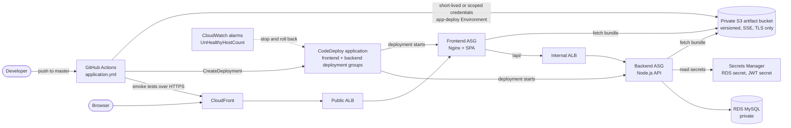
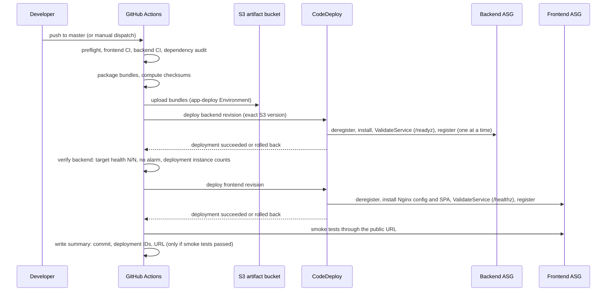

# Application delivery design: CodeDeploy to the private Auto Scaling Groups

Status: **design only. Nothing in this document is implemented, planned, applied, or tested on AWS.** Facts marked *verified* come from reading this repository (file references given) or from GitHub Actions run metadata. Statements about AWS service behavior come from general knowledge and are marked *assumption*: re-check them against current AWS documentation and prove them in a throwaway environment before building. Decisions that need your approval are collected in section 14.

## 1. Summary

- **Recommended mechanism:** AWS CodeDeploy (EC2/on-premises platform, in-place rolling deployments) with immutable, versioned bundles in a private, versioned, encrypted S3 bucket. GitHub Actions builds and publishes the bundles and starts the deployments; CodeDeploy runs them on the instances, gating on load balancer health and CloudWatch alarms, and rolls back automatically.
- **Order:** backend deployment and verification, then frontend deployment, then smoke tests through the public URL. The workflow reports the deployed commit, the CodeDeploy deployment IDs and the verified URL.
- **Why:** it maps onto the two Auto Scaling Groups, target groups and alarms that already exist, it gives health-gated rolling updates and rollback without writing orchestration code, and its CI permissions are narrow (publish a bundle, start a deployment) instead of remote command execution.
- **Not recommended:** SSM Run Command (more custom code, broader CI power), containers (needs a registry and an orchestrator or Docker on the hosts; no evidence they are needed), and re-launching instances through Terraform for every release.
- **Today's symptom this explains:** the infrastructure check fails because the instances run a placeholder bootstrap and never answer the load balancer health check (section 2).

## 2. Verified current state and gaps

| Area | Verified fact (source) | Gap for delivery |
| --- | --- | --- |
| Compute | Two ASGs (frontend, backend), min 2 / desired 2 / max 4, `health_check_type = "ELB"`, grace period 300 s, rolling `instance_refresh` with 50% minimum healthy, one launch template per tier, Amazon Linux 2023 AMI, IMDSv2 required, no public IPs, encrypted root volume (`modules/compute/main.tf`, `variables.tf`) | User data is a placeholder that installs nothing (`modules/compute/templates/*.tftpl`), so no instance can pass the health check and the ASG keeps replacing instances (confirmed indirectly: the infrastructure check reported 2 of 3 instances healthy in each group, run 39851704969). |
| Load balancing | Public ALB to frontend target group on port 80; internal ALB (port 80) to backend target group on port 3000; health checks interval 30 s, timeout 5 s, thresholds 3/3, matcher 200-399; dev passes path `/healthz` to both (`modules/alb`, `environments/dev`) | None for paths; deregistration delay and slow start are not configured. |
| Security groups | Frontend accepts 80 from the public ALB group; internal ALB accepts 80 from the frontend group; backend accepts 3000 from the internal ALB group; database accepts 3306 from the backend group; all instance groups allow all outbound (`modules/security`) | Outbound is open, so installers and S3 work through NAT; no SSH rule exists (good). |
| Network | Private app subnets route to a NAT gateway; no VPC endpoints exist (`modules/network`) | Every package, agent installer, S3 and Secrets Manager call depends on NAT (single point of failure if `single_nat_gateway` is true). |
| IAM | One shared EC2 role with `CloudWatchAgentServerPolicy` only; no S3, no Secrets Manager, no SSM (`modules/iam`) | No artifact read, no secret read, no per-tier separation. |
| Storage | Only the ALB log bucket and the Terraform state bucket exist | No artifact bucket. |
| Frontend app | Vite build to `dist/`; `deploy/nginx.conf.template` serves `/healthz` itself, serves the SPA, proxies `/api/` to the internal ALB (port 80) with the original URI (`application/frontend`) | Nothing installs Nginx or places the files. |
| Backend app | Fastify on port 3000; `GET /healthz` (no database), `GET /` (no database), `GET /readyz` (database check with timeout); API routes are under `/api/v1/...`; production config requires `JWT_SECRET`, `CORS_ORIGINS`, `COOKIE_SECURE`, `DB_*`, `DB_SSL_CA_PATH`; `deploy/oriel-backend.service` expects `/opt/oriel/backend` and `/etc/oriel/backend.env` (`application/backend`) | Nothing installs Node.js, the code, the environment file or the service. |
| Database | RDS MySQL, private, master password managed by RDS in Secrets Manager (`modules/database`); migrations run with `npm run migrate` and take a MySQL advisory lock so concurrent runs serialize (`src/db/migrate.ts`) | The backend would use the master user (no separate application user); nothing grants the backend the secret; migrations and the admin seed have no execution path inside the VPC. |
| CloudFront | Default behavior caches nothing and forwards everything; origin is the public ALB over HTTP with a secret header (`modules/cloudfront`) | None for delivery. |
| Monitoring | Alarms for ELB 5xx, UnHealthyHostCount (frontend and backend), CPU (3), RDS storage; SNS topic (`modules/monitoring`) | Alarm names are not exported, so CodeDeploy cannot reference them yet. |
| CI | `application.yml`: preflight, frontend/backend CI, dependency audit, optional read-only infrastructure check, summary. No deploy stage. Terraform uses access keys, not OIDC, by an earlier decision (`docs/runbooks/ci-cd.md`) | No build-to-deploy path; no deploy identity. |

## 3. Options compared

| Criterion | SSM Run Command / State Manager | **CodeDeploy (recommended)** | Containers |
| --- | --- | --- | --- |
| Fit with this repository | Needs new orchestration code; the existing ASG, target groups and alarms are not used for gating | Native ASG and target group integration; reuses the existing alarms | No ECR, no Docker on hosts, no cluster; would add a registry plus ECS or Docker-on-EC2 and a different bootstrap |
| Rolling deploy and health gating | DIY with `max-concurrency`, `max-errors` and custom checks; no automatic deregistration | One/half at a time, deregister from the target group, run validation hooks, re-register | Depends on the orchestrator |
| New instances from Auto Scaling | DIY (State Manager association or user data pull) | Built in: CodeDeploy hooks into the ASG launch and deploys the last successful revision before the instance goes in service (*assumption*) | Orchestrator handles it |
| Rollback | DIY re-run of an older document | Automatic on failure or alarm; redeploy any earlier revision | Orchestrator handles it |
| CI permission blast radius | `ssm:SendCommand` on instances is remote command execution | Put a bundle in one prefix, create a deployment in one application and two groups; cannot run arbitrary commands | ECR push plus service update |
| Instance software | SSM Agent (preinstalled on AL2023) and `AmazonSSMManagedInstanceCore`; needs SSM endpoints or NAT | CodeDeploy agent (installed by user data from a public regional bucket over NAT or an endpoint) | Docker or ECS agent |
| Complexity | Low at first, grows with every custom rule | Moderate once (application, two groups, service role, appspec and hooks), low per release | High; a major architectural change |
| Cost | Free service | Free for EC2/on-premises deployments (*assumption*, re-check pricing) | Registry storage, orchestration |

Decision: CodeDeploy. Keep Session Manager as a separate, optional, break-glass decision (section 14, item 9); it is not needed to deploy. Containers are rejected: nothing in the repository requires them, and the application is a Node.js process behind Nginx.

## 4. Target architecture

New pieces: the artifact bucket, the CodeDeploy application and two deployment groups, split instance roles, user data that prepares an instance to receive a bundle, and deploy jobs in `application.yml`. Existing pieces reused: ASGs, target groups, ALBs, alarms, NAT, Secrets Manager secret of the database.

## 5. Artifacts and versioning

- **Version = the full commit SHA** (40 characters). Bundles are immutable: a path is written once and never overwritten.
- **Layout** (one bucket, two prefixes so IAM can separate tiers):
  - `releases/frontend/<sha>/frontend-<sha>.zip`
  - `releases/backend/<sha>/backend-<sha>.zip`
  - `releases/<tier>/<sha>/SHA256SUMS` with the bundle checksum, written by CI.
- **Frontend bundle:** `dist/`, `appspec.yml`, `scripts/`, `nginx.conf.template`.
- **Backend bundle:** `dist/`, `package.json`, `package-lock.json`, production `node_modules` built in CI (`npm ci --omit=dev`; the dependencies are pure JavaScript, which must be re-confirmed with `npm ls` and a search for native add-ons before relying on it), `oriel-backend.service`, `appspec.yml`, `scripts/`. Bundling `node_modules` removes a runtime dependency on the npm registry (decision, section 14, item 5).
- **Integrity controls:** the bucket is versioned; CI records the S3 object **version ID and ETag** of what it uploaded and passes exactly that version to CodeDeploy (a deployment names an exact object version, so a later overwrite cannot be deployed by accident). Only the CI deploy identity can write to `releases/*`; instance roles can only read their own tier prefix; no one else gets `s3:PutObject`. Limits: a checksum file stored beside the bundle does not protect against someone who can write both, so the real controls are write restriction, version pinning and audit; S3 Object Lock or signed attestations are optional hardening (decision, item 11).
- **Retention:** current versions kept as rollback history (default 90 days or the last N releases; decision), noncurrent versions expire after 30 days, incomplete uploads aborted after 7 days.

## 6. End-to-end flow

How this meets the ten required behaviors:

1. **Checks first:** the deploy jobs `needs` the existing quality, build and audit jobs; they never run on pull requests.
2. **Build and version:** a `package` job builds both bundles from the same commit that passed the checks.
3. **Private S3:** a `publish` job uploads with SSE and records version ID and ETag; the bucket policy denies non-TLS and unencrypted writes and blocks public access.
4. **Authorization:** deploy jobs run only on push to the deployment branch or manual dispatch, inside a protected GitHub Environment (`app-deploy`) with a deployment-branch restriction (and optional reviewers).
5. **Backend before frontend:** `deploy-backend` then `verify-backend` then `deploy-frontend`; a failed or rolled-back backend stops the pipeline.
6. **New instances:** the user data prepares the base software and the CodeDeploy agent; CodeDeploy deploys the last successful revision to an instance launched by Auto Scaling before it goes in service (*assumption*, test in section 13).
7. **Health endpoints:** target groups use `/healthz` on both tiers (liveness, database-free, already the dev default). The backend `ValidateService` hook calls `http://localhost:3000/readyz` (database included) so a deployment fails if the database is unreachable, while the load balancer is not tied to the database. The frontend hook calls `http://localhost/healthz` and `http://localhost/`.
8. **No replacement loops:** see section 9.
9. **Failure and rollback:** see section 10.
10. **Reporting:** the summary job prints the commit, version, deployment IDs, per-tier instance counts, and the URL only after the smoke tests pass.

## 7. IAM and security design

| Principal | Allowed (design) | Notes |
| --- | --- | --- |
| GitHub deploy identity (CI) | `s3:PutObject` (and `s3:GetObject` for read-back) on `releases/*` of the artifact bucket; `codedeploy:CreateDeployment`, `GetDeployment`, `GetDeploymentTarget`, `ListDeploymentTargets` on the application's two deployment groups; `codedeploy:GetApplicationRevision`, `RegisterApplicationRevision` on the application; `codedeploy:GetDeploymentConfig` on the chosen configs; `elasticloadbalancing:DescribeTargetHealth` and `autoscaling:DescribeAutoScalingGroups` (read-only; these do not support resource scoping) | No SSM, EC2 write, IAM, Secrets Manager or Terraform state access. Separate from the plan and apply identities in `docs/runbooks/ci-cd.md`. |
| CodeDeploy service role | Trusted by `codedeploy.amazonaws.com`; AWS-managed `AWSCodeDeployRole` | Lets CodeDeploy describe instances and manage the ASG lifecycle and target group registration. |
| Frontend instance role | `CloudWatchAgentServerPolicy`; `s3:GetObject` on `releases/frontend/*` | Cannot read the database secret or the backend prefix. |
| Backend instance role | `CloudWatchAgentServerPolicy`; `s3:GetObject` on `releases/backend/*`; `secretsmanager:GetSecretValue` on exactly the RDS secret ARN and the JWT secret ARN; `kms:Decrypt` only if a customer-managed key is introduced | Replaces the shared role for this tier. |
| Terraform apply identity | Must be allowed to create the new resources (bucket, CodeDeploy, roles) | Its permission set is not defined in this repository today and must be designed with this change. |

**Credentials for GitHub.** Preferred: a GitHub OIDC role (the `token.actions.githubusercontent.com` identity provider plus an IAM role whose trust policy pins `aud` and a `sub` such as `repo:<owner>/<repo>:environment:app-deploy`; the repository is public, so an unpinned trust policy would be unsafe) and `id-token: write` only on the deploy jobs. The repository currently uses static access keys for Terraform by an explicit earlier decision; the equivalent here is a dedicated IAM user with only the permissions above, keys stored as secrets of the `app-deploy` Environment. Both are supported by this design; the choice is yours (item 1).

**Other requirements:**
- **No secrets in artifacts, source or user data.** The database password and the JWT secret are read from Secrets Manager by the backend hook at install time and written to `/etc/oriel/backend.env` (mode 0600, root). User data carries only non-secret settings (database host and name, user name, secret ARNs, allowed origin, internal ALB DNS name).
- **Artifact bucket policy:** block public access, `BucketOwnerEnforced`, versioning, SSE (SSE-S3 or a customer-managed key, decision item 6), deny `aws:SecureTransport = false`, deny uploads without server-side encryption, restrict `GetObject` to the two instance roles and `PutObject` to the CI identity.
- **No SSH.** No inbound rule is added. Break-glass access, if wanted, is Session Manager (separate decision).
- **Deployment authorization:** GitHub Environment protection plus branch restriction; the AWS side trusts only that Environment (OIDC `sub`) or that user.
- **Audit:** CloudTrail (account level) records CodeDeploy and S3 API calls (*assumption*: confirm a trail exists); CodeDeploy keeps deployment history per application; the workflow summary records commit, version and IDs.
- **Logging:** CloudWatch agent ships `/var/log/bootstrap.log`, the CodeDeploy agent and deployment logs, Nginx logs and the API logs from the journal; log groups are created in Terraform with retention.
- **Network:** NAT remains the default path. Hardening: an S3 gateway endpoint (no hourly charge) and interface endpoints for Secrets Manager, CloudWatch Logs and CodeDeploy, which also removes NAT as a single point of failure for deployments (item 8).

## 8. Required Terraform changes (not implemented)

| Module | Change |
| --- | --- |
| `modules/delivery` (new) | Artifact bucket with the controls above; `aws_codedeploy_app` (Server); CodeDeploy service role; two `aws_codedeploy_deployment_group`s on `frontend_asg_name` / `backend_asg_name` with `load_balancer_info` set to the existing target groups, `deployment_config_name` `CodeDeployDefault.OneAtATime` first and `HalfAtATime` later, `auto_rollback_configuration` on `DEPLOYMENT_FAILURE` and `DEPLOYMENT_STOP_ON_ALARM`, `alarm_configuration` with the unhealthy-host alarms; CI deploy identity (OIDC role or user) with the policy in section 7; JWT secret container; outputs for bucket, application and group names. Variables: `project_name`, `environment`, ASG names, target group names, alarm names, bucket retention days, deployment config names, `github_repository` and environment name (OIDC), `kms_key_arn` (optional). |
| `modules/iam` | Split the shared EC2 role and profile into `frontend` and `backend` roles with the permissions in section 7; export one instance profile name per tier. |
| `modules/compute` | One instance profile per tier; user data renders non-secret settings, installs the CodeDeploy agent, Nginx (frontend) or Node.js (backend), creates users and directories, starts the agent, and keeps logging to `/var/log/bootstrap.log`; document the interaction with `instance_refresh` (section 9). |
| `modules/monitoring` | Export the alarm names used by the deployment groups. |
| `modules/network` | Optional endpoints (item 8). |
| `modules/database` / `environments/dev` | Export database name and user; wire the new module and outputs (`artifact_bucket_name`, `codedeploy_app_name`, group names, `site_record_names`); ideally add a least-privilege application database user (item 7). |
| Bootstrap policy | The Terraform apply identity needs the permissions to create these resources. |

## 9. Startup, health checks and Auto Scaling

- **Base software at launch, application at deploy.** User data installs only what does not change per release (agent, Nginx or Node.js, directories, service user). It must not start serving a fake `/healthz`, or the load balancer would route to an instance with no application.
- **No replacement loop for new instances.** With the CodeDeploy agent and a deployment group attached to the ASG, an instance launched by Auto Scaling waits in a launch lifecycle hook until CodeDeploy has installed the last successful revision, and only then goes in service and registers with the target group (*assumption*, to be proven in section 13). It therefore never sits unhealthy in the target group waiting for an application.
- **The first-deployment gap.** Until a first revision has succeeded, instances have nothing to deploy and will fail ELB health checks, which is exactly today's behavior. Mitigation, to be decided (item 4): run the first deployment immediately after the infrastructure apply, and consider setting `health_check_type = "EC2"` until a first revision exists so the ASG does not churn instances in the meantime; switch back to `"ELB"` afterwards.
- **Terraform changes versus application deploys.** A launch template change starts an `instance_refresh`; replacement instances get the last successful revision through the same hook. Do not run `terraform apply` and an application deployment at the same time (they currently use different concurrency groups); the deployment job should refuse to start while an instance refresh is in progress (read-only check of the ASG).
- **Health check settings to review:** grace period (300 s) must exceed install time plus warm-up (measure in the throwaway test); target group deregistration delay should cover in-flight requests; thresholds 3/3 at 30 s mean about 90 s to mark an instance healthy.
- **Capacity during a deployment.** With two instances per tier, one-at-a-time means half the capacity serves traffic during the roll. That is acceptable for dev; for higher availability raise desired capacity or use blue/green (it temporarily doubles instances; decision, item 3).
- **Database changes.** Migrations run in a backend hook (they take the advisory lock, so concurrent instances serialize). Because old and new application versions run side by side during a roll, migrations must be backward compatible (expand, then contract in a later release). The admin seed stays a deliberate, manual, one-off action.

## 10. Failure detection and rollback

- **Detection:** a failed lifecycle hook, a failed `ValidateService`, the unhealthy-host alarm firing during the deployment, or the deployment exceeding its timeout. The CI job polls the deployment until a terminal state and fails on anything but success.
- **Automatic rollback:** CodeDeploy redeploys the last successful revision on failure or alarm (*assumption*; verify its behavior on instances already updated). The CI job reports `rolled back` explicitly and still fails.
- **Manual rollback:** run the workflow manually with an earlier commit SHA as the revision input; it redeploys that exact stored bundle (backend first, then frontend). No rebuild is needed because bundles are immutable and versioned. Do not delete releases that may be rolled back to.
- **What rollback does not cover:** database migrations (fix forward; keep them backward compatible), infrastructure changes (go through `terraform.yml`), and a bad revision that was the last successful one (then deploy an older SHA by hand).
- **Safety:** nothing in the pipeline terminates instances or deletes resources; rollback is a new deployment of an existing bundle.

## 11. GitHub Actions design (extends `application.yml`; no new workflow file)

New jobs run only on a push to the deployment branch or a manual dispatch with a `deploy` input, never on pull requests:

| Job | Needs | Does |
| --- | --- | --- |
| `package` | frontend-ci, backend-ci, dependency-audit | Build both bundles from the checked commit; compute SHA-256; upload as short-lived workflow artifacts (or rebuild in `publish`). |
| `publish` | package | In the `app-deploy` Environment: upload to S3 with SSE; output version ID and ETag per bundle. |
| `deploy-backend` | publish | Create the backend deployment for the exact object version; wait; fail on rollback or failure. Concurrency group `app-deploy`, never cancelled. |
| `verify-backend` | deploy-backend | Backend target group has all targets healthy; no deployment instance failed; the alarm is not in ALARM. |
| `deploy-frontend` | verify-backend | Same for the frontend. |
| `smoke-tests` | deploy-frontend | Public HTTPS checks with bounded retries (below). |
| `deploy-summary` | all, `if: always()` | Commit, version, deployment IDs, instance counts, result, URL only if smoke tests passed. |

Preflight gains a check (names only) for the deploy settings when deploying. Secrets and variables, by name:

- Variables: `AWS_REGION`; `APP_ARTIFACT_BUCKET`; `CODEDEPLOY_APP_NAME`; `CODEDEPLOY_FRONTEND_GROUP`; `CODEDEPLOY_BACKEND_GROUP`; `BACKEND_TARGET_GROUP_ARN`; `APP_BASE_URL` (the public HTTPS URL, taken from the Terraform output `site_record_names`). These are set once from Terraform outputs after the apply, so the deploy identity never needs to read the Terraform state (which contains secrets).
- Credentials: either the OIDC role ARN (variable) or the deploy user's keys (Environment secrets) in `app-deploy`.
- Actions are pinned to full commit SHAs, as in the current workflow; deploy jobs use `contents: read` plus `id-token: write` only if OIDC is chosen.

**Smoke tests (read-only, no writes, no logins):** through `APP_BASE_URL`: `GET /` returns 200 with HTML; `GET /healthz` returns 200 `ok`; `GET /api/v1/categories` and `GET /api/v1/products` return 200 JSON; one fingerprinted asset referenced by the page returns 200; the response carries the expected security headers. Retry up to a fixed limit with backoff, then fail. The backend `/healthz` and `/readyz` are not reachable through the public path (only `/api/` is proxied), so backend health is proven by the deployment hooks and target group health, not by a public call. Checkout, registration and admin flows are not exercised in production-like smoke tests. The verified application URL is reported only when all of this passes.

## 12. Cost and operational risks

- **Cost (estimates, re-check current pricing):** CodeDeploy for EC2 has no per-deployment charge; S3 storage for a few hundred megabytes is negligible; an S3 gateway endpoint is free; each interface endpoint costs roughly a few cents per hour per Availability Zone plus data (about USD 7 to 8 per month per endpoint per AZ), which is why endpoints are an explicit decision; CloudWatch log ingestion and retention scale with log volume; blue/green deployments temporarily double instance hours.
- **Risks:** NAT as a single point of failure during deployments and instance launches; the first-deployment gap and churn; a bad last-good revision; migrations that are not backward compatible; the application using the database master user; the CodeDeploy agent or hook scripts failing silently (mitigate with logs and alarms); concurrent Terraform apply and deployment; account-wide OIDC provider already existing (conflict); deployment authority concentrated in one Environment (keep reviewers and branch rules).

## 13. Phased implementation plan and acceptance criteria

| Phase | Work | Acceptance criteria |
| --- | --- | --- |
| 0. Decisions | Resolve section 14 | Written approvals. |
| 1. Foundation (Terraform only) | Delivery module, split IAM, compute user data, alarm exports, JWT secret container | `terraform validate` and plan reviewed with no unexpected deletions or replacements; in a throwaway environment: bucket policy denies plain HTTP, unencrypted writes and cross-tier reads; instances start the agent and appear in the deployment group. |
| 2. Packaging and hooks | `appspec.yml` and scripts for both tiers; bundle build | A bundle deploys by hand to one test instance; `ValidateService` fails when the database is unreachable and passes when it is; no secret appears in the bundle, user data or logs. |
| 3. Pipeline | Deploy jobs, preflight additions, summary | A non-production run deploys backend then frontend; stopping the backend deployment prevents the frontend deployment; the summary shows commit, IDs and a URL only after smoke tests pass. |
| 4. Failure drills | Bad revision, alarm trigger, scale-out and instance-refresh during a deployment | Automatic rollback restores the previous revision; a manual redeploy of an older SHA works; a new instance launched by Auto Scaling comes in service already running the last good revision and no replacement loop occurs. |
| 5. Hardening | VPC endpoints, application database user, customer-managed key, Object Lock or attestations, OIDC if not chosen earlier | Deployments succeed with NAT unavailable (if endpoints are chosen); the application no longer uses the master user. |

## 14. Decisions requiring your approval

1. Deploy credentials: GitHub OIDC role (recommended) or a dedicated IAM user with keys in the `app-deploy` Environment.
2. Create the `app-deploy` GitHub Environment (branch restriction, optional reviewers) and the deploy variables listed above.
3. Deployment strategy and capacity: in-place `OneAtATime` then `HalfAtATime` (recommended for dev) versus blue/green; raise desired capacity for production?
4. First-deployment handling: temporarily use `health_check_type = "EC2"` until a revision exists, or accept churn and deploy immediately after apply.
5. Bundle production `node_modules` in the artifact (recommended) versus `npm ci` on the instance.
6. SSE-S3 versus a customer-managed KMS key for the artifact bucket and the database secret.
7. Application database user with least privilege instead of the RDS master user, and who runs migrations and the seed.
8. VPC endpoints now or keep NAT only.
9. Session Manager for break-glass access (adds `AmazonSSMManagedInstanceCore` and endpoints/NAT) or none.
10. JWT secret creation: Terraform-generated value (ends up in state, like the origin secret) versus a value set out of band.
11. Artifact integrity extras: S3 Object Lock, signed provenance, release retention length.
12. How to expose the deployed version to CI beyond CodeDeploy revision data (for example a version string in a public health response requires an application change).
13. Whether Terraform apply and application deploys should share one concurrency lock.

## 15. What is verified and what is not

- **Verified:** repository facts in section 2; run 39851704969 showed `frontend_asg_name has 2/3 healthy in-service instances` and `backend_asg_name has 2/3 healthy in-service instances`; Terraform and application workflows as described.
- **Not verified (assumptions):** CodeDeploy agent installation and behavior on Amazon Linux 2023; the launch lifecycle hook behavior for new instances; automatic rollback details; Node.js 22 and Nginx package names on AL2023; IAM policy sufficiency; every price; whether CloudTrail and a GitHub OIDC provider already exist in the account. None of this has been tested against AWS, and no AWS account was contacted for this document.
